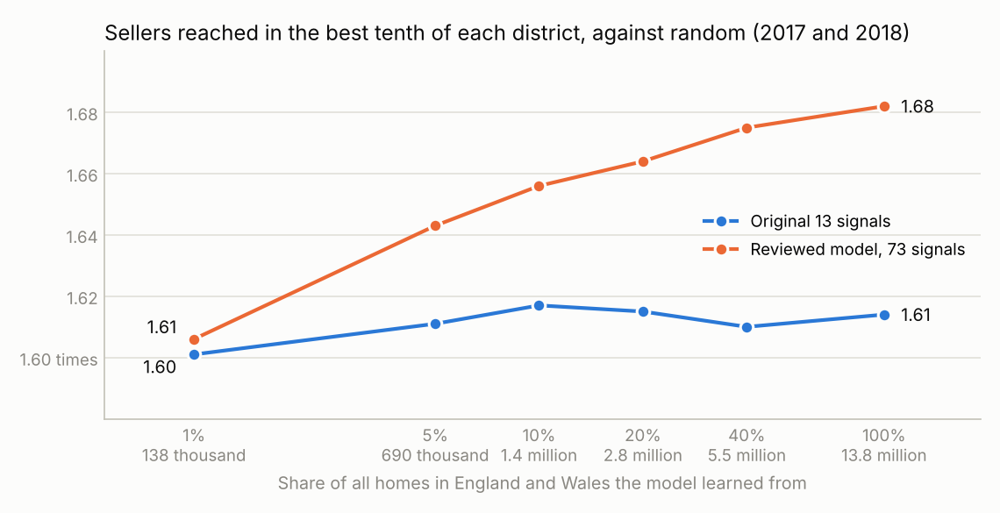
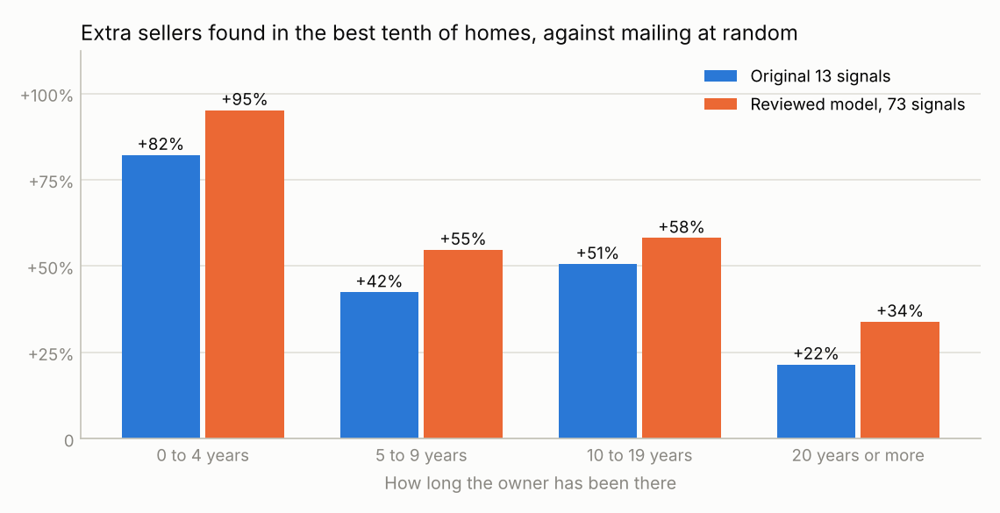

# The whole country, and a harder look at the model

The earlier work trained the "who is about to sell?" model on a 5%
sample of homes and 13 signals. The question for this round was direct:
**would far more training data, and a model built around the quirks of
this particular data, unlock bigger effects?**

The short answer: yes, a measurable one, and we now know its size and
where it stops.

| | Before | Now |
|---|---|---|
| Homes the model learned from | 690 thousand (5%) | 13.8 million (every home that has sold since 1995) |
| Home-years of history | 9.5 million | 190 million |
| Signals per home | 13 | 73 |
| Sellers reached by writing to the best tenth of a district, against random | 1.61 times | 1.68 times |
| The best twentieth of a district | 1.70 times | 1.82 times |
| Owners of 20 years or more, best tenth | 1.17 times | 1.25 times |

Five findings, in plain terms:

1. **The reviewed model is better, and the gain is real.** In its best
   tenth it reaches 4% more sellers per card, and in its best twentieth
   7% more. The range on the first figure is 3% to 6%.
2. **More data helps the richer model and does nothing for the simple
   one.** The original 13 signals had learned all they could from 1% of
   the country. The 73-signal model is no better than the original at
   1%, clearly better at 5%, and was still creeping upwards when given
   every home in the country. So the instinct was right: detailed
   signals need national-scale data before they pay. But each doubling
   of data adds only about 0.01, and with every home now in the table
   there are no doublings left. There is no step change in it.
3. **Air quality, distances and the national view layer add nothing to
   local targeting.** Take either family out of the model and its
   ranking inside a district does not change. For views this was tested
   on every home in the country, which settles it.
4. **Long-held homes remain the weak spot.** For owners of 20 years or
   more the original model manages 1.17 times random. Trained on every
   home, the reviewed model reaches 1.25. That is encouraging rather
   than proven, because this group is small in the test and its figure
   wobbles. Refitting every year adds a little more.
5. **The business sums move by £5 a conversation.** The next step up
   will come from new kinds of information, not from more of the same.

## 1. What it was trained on

- 24,254,747 sales in England and Wales, 1995 to 2019, linked into
  13,790,299 homes.
- The national records were rebuilt in full for this round. The
  previous round's view test had kept only Exeter's rows, which was
  enough for one city and not for this.
- A table with one row for every year a home was owned and could have
  been sold: 190 million rows for all 13.8 million homes, with 9.2
  million sales among them.
- Every row carries 73 signals, each using only what was known at the
  start of that year.
- The model learns from 2001 to 2015 and is tested on 2017 and 2018,
  years it has never seen: 2.6 million home-years and 104,012 sales.
  2019 is left out of the headline because that year's file was still
  missing late registrations.

## 2. What is particular about this data, and what changed because of it

"Review the model" could mean many things. We took it to mean: list
what is unusual about Land Registry sale records, and make sure the
model and the way it is judged respect each point.

| What is particular | Why it matters | What we changed |
|---|---|---|
| A sale is rare: about 4 home-years in 100 | Nearly all the data is "nothing happened" | Train on every sale and one non-sale in four, weighted back. Over three times cheaper, no loss (section 8) |
| The same home appears again and again | A home that has changed hands often tends to do so again | Signals for each home's own history: how many past sales, how long past owners stayed |
| We see the price at both ends of an ownership | People sell when they are well ahead, and sit tight when they are not | The owner's paper gain since buying, and how fast it has grown |
| 1.2 million postcodes inside 9 thousand sectors inside 2,300 districts | Turnover is very local, and local habits persist | Sale rates for the postcode, the sector and the district, each measured only up to the year before |
| The market moves in cycles | A model trained in a boom misjudges a slump | Signals for the state of the national and local market; and refit every year (section 7) |
| New estates sell in waves | Everyone on a new estate bought in the same two years | The age of the postcode and its share of new-builds |
| History only starts in 1995 | We cannot tell 25 years of ownership from 40 | Report long-held homes separately, so their weakness is never hidden in an average |
| The last year is always incomplete | Late registrations make the latest year look quiet | Test on 2017 and 2018, not 2019 |
| One home contributes many rows | Rows from the same home are not independent, so naive error bars are too narrow | Every range in this document comes from re-sampling whole homes, not rows |
| Campaigns are local | Knowing that one town turns over faster than another is no help once a buyer has picked the town | Judge the ranking inside each district (section 3) |

## 3. A fairer yardstick

Until now the model was judged on how well it ranks every home in the
country against every other. That flatters it. Part of that skill is
knowing that, say, a commuter town turns over faster than a retirement
town. A buyer has already chosen where to live. What matters is which
doors *in that district* to write to.

So the headline measure is now this: **in each postcode district, write
to the tenth of homes the model rates highest. How many times more
sellers does that reach than a random tenth?** We call it local lift.
There are 4,615 district-years in the test.

Local lift comes out about 0.05 lower than the national figure, and it
is the honest one. It also turned out to be the more revealing one: the
national score suggested that more data had stopped helping, and the
local score shows it had not. All business sums below use it.

## 4. What each change bought

Trained on a tenth of the country. Signals are added one family at a
time.

| Signals | Count | Local lift, best tenth | National lift, best tenth | National, best hundredth |
|---|---|---|---|---|
| Original | 13 | 1.62 | 1.65 | 1.91 |
| + each home's history, local rates, market state | 38 | 1.65 | 1.72 | 2.09 |
| + air quality and distances | 51 | 1.66 | 1.68 | 2.02 |
| + national views instead | 60 | 1.64 | 1.72 | 2.09 |
| Everything | 73 | 1.66 | 1.72 | 2.11 |

Changes in local lift, with ranges from re-sampling homes:

- **History and local rates: a real gain.** +0.03 (range 0.01 to 0.05).
  Essentially all of the improvement in this document comes from here.
- **Air quality and distances: nothing.** +0.01 (range −0.01 to +0.03).
- **National views: nothing.** −0.01 (range −0.02 to +0.01).
- **Everything against the original: +0.04** (range 0.02 to 0.06).

### What the model leans on

Two thirds of the model's decisions use the new history signals. The
single most useful signal is the sale rate in the postcode sector over
the previous five years. After that: district turnover, how long the
owner has been there, the kind of home and its price band, the owner's
paper gain, and the state of the national market.

Its forecasts are also honest in level. Homes it rates as 3.3% likely to
sell go on to sell 3.4% of the time, and so on across the range.

## 5. Does more data help?

Local lift in the best tenth of each district:

| Share of the country | Homes | Original 13 signals | Reviewed 73 signals | Gain from the review |
|---|---|---|---|---|
| 1% | 138 thousand | 1.60 | 1.61 | +0.01 (−0.02 to +0.03) |
| 5% | 690 thousand | 1.61 | 1.64 | +0.03 (0.01 to 0.05) |
| 10% | 1.4 million | 1.62 | 1.66 | +0.04 (0.02 to 0.06) |
| 20% | 2.8 million | 1.62 | 1.66 | +0.05 (0.03 to 0.07) |
| 40% | 5.5 million | 1.61 | 1.68 | +0.06 (0.04 to 0.08) |
| 100% | 13.8 million | 1.61 | 1.68 | +0.07 (0.05 to 0.09) |

**The simple model was already full.** With 13 signals, a hundred times
more data changes nothing: 1.60 at 1% of the country, 1.61 with every
home in it.

**The richer model needs the data.** At 1% its extra 60 signals buy
nothing. The same signals are worth +0.03 at 5% and +0.07 with every
home. That is the precise sense in which more training data unlocks
bigger effects: the detail in the signals can only be learned from a
lot of examples.

**But the slope is shallow, and the data has now run out.** From 1% to
5% the reviewed model gains 0.04. From 5% to every home, twenty times
more data, it gains another 0.04 (range 0.02 to 0.06): about 0.01 for
each doubling. The last step, from 40% of homes to all of them, added
0.01 (range −0.01 to +0.02). There is no more data of this kind to add.
This is every recorded sale from 1995 to 2019.

On the national measure the every-home model reaches 1.75 times random
in its best tenth and 2.23 times in its best hundredth, against 1.64
and 1.92 for the original trained on 5% of the country.

## 6. Owners by how long they have stayed

The chart compares the two models, both trained on every home, on the
national measure.

The model is at its best on recent buyers and weakest where the
business most needs it. For owners of 20 years or more, trained on
every home:

| Owners of 20 years or more, best tenth | Original | Reviewed, every home | Gain |
|---|---|---|---|
| Ranked within a district | 1.17 | 1.25 | +0.07 (0.00 to +0.15) |
| Ranked nationally | 1.22 | 1.34 | +0.12 (0.03 to 0.20) |

Read this with care. Long-held homes are a small part of the test, 6,230
sales, and on smaller training samples the same comparison came out
anywhere between −0.03 and +0.09. The every-home figure is the largest
and steadiest fit we have, and both measures agree in direction, so it
is the best evidence yet that the richer model helps here. It is not
yet beyond doubt, and this is still the weakest group by a distance.

This is not a modelling failure. A long-held home has one sale on
record, decades ago, and nothing since. What would tell us that its
owner is thinking of moving, such as a death, a divorce, retirement, an
empty nest or a failing boiler, is simply not in sale records.

## 7. Refit every year

A model trained once on data to 2015 goes stale. We compared it with a
model refitted each year on everything up to the year before, which is
how it would run in practice. Trained on 5% of the country, scored on
the national measure:

| Test year | Frozen in 2015 | Refitted to the year before | Change |
|---|---|---|---|
| 2017, all homes | 1.72 | 1.75 | +0.02 (0.00 to +0.05) |
| 2018, all homes | 1.72 | 1.75 | +0.04 (0.02 to 0.06) |
| 2017, owners of 20 years or more | 1.26 | 1.32 | +0.05 (−0.05 to +0.16) |
| 2018, owners of 20 years or more | 1.32 | 1.38 | +0.06 (−0.05 to +0.17) |

Refitting is worth about as much as the whole of the geography and view
work was hoped to be, and it is free. It helps long-held homes most,
for a simple reason: a model frozen in 2015 has never seen anyone who
has owned for more than 20 years, because the records only begin in
1995. Each extra year of data shows it owners one year further on. The
ranges for long-held homes are wide, but a second measure of ranking
skill confirms the 2017 gain clearly.

The frozen model also drifts in level. In 2017 it expected 3.8% of homes
to sell when 4.1% did. The refitted model expected 4.1%.

## 8. Keeping every sale and a quarter of the rest

Sales are rare, so most rows say "nothing happened" and add little.
Training on every sale but only one non-sale in four, each counted four
times, makes the largest fits over three times cheaper. The check, on 5%
of the country:

| Trained on | Rows | National lift, best tenth |
|---|---|---|
| Every row | 6.9 million | 1.68 |
| Every sale, one non-sale in four | 2.0 million | 1.69 |

No loss. Forecasts stay correctly scaled because the weights put the
missing rows back.

## 9. Geography and views, with everything else in

The earlier view test used one city's sale records. This is the
national version, in two parts.

**Views, on every home.** The same model, trained on all 13.8 million
homes, with and without the 22 national view signals:

| Model, trained on every home | Local lift | National lift |
|---|---|---|
| Everything | 1.68 | 1.75 |
| Without the national views | 1.69 | 1.72 |

Inside a district the views add nothing: −0.01 (range −0.03 to +0.01).
On the national measure they add a small real amount: +0.03 (range 0.01
to 0.04). So with every home in the country behind it, the view signal
does exist, and it is about which parts of the country turn over
faster. It does not help choose between two homes in the same town,
which is the only choice a campaign makes.

**Both families, on a fifth of the country.** Take one family out and
see what is lost.

| Model | Local lift | National lift |
|---|---|---|
| Everything | 1.66 | 1.73 |
| Without the national views | 1.67 | 1.70 |
| Without air quality and distances | 1.66 | 1.75 |

Locally, neither family matters: removing views changes local lift by
0.00 (range −0.01 to +0.02), removing geography by 0.00 (range −0.02 to
+0.01).

The national column tells a different story, and it is a useful
warning. There, views help and geography hurts. Both effects are about
telling regions apart, which a campaign does not need.

### Why geography can hurt on the national measure

Where a home is does not change from year to year, so a model given
detailed geography can memorise which parts of the country used to turn
over fastest. It learned that from 2001 to 2015. Then the pattern
shifted. In 2017 and 2018, sales in Greater London ran 21% below their
2013 to 2015 level, and Surrey and Hertfordshire 16% below, while
Merseyside ran 23% above and Lancashire 17% above. The memorised map
was out of date by the time of the test.

Inside a single district the problem disappears, because everyone in
the district shares the same market. That is one more reason to judge
the model locally, and a warning: **fixed facts about a place are a
liability in a model that is not refitted often.**

## 10. What it means for the business

Using the same assumptions as before (72p a card, 1 owner in 100 reads
their offer, 1 reader in 3 starts a conversation):

| | Original model, 5% of the country | Reviewed model, every home |
|---|---|---|
| Sellers reached, best tenth of a district, against random | 1.61 times | 1.68 times |
| Replies per 1,000 cards | 5.3 | 5.6 |
| Postage per conversation started | £135 | £130 |

Five pounds. The conclusion of
[04-does-open-geography-help.md](04-does-open-geography-help.md) stands
and is now much firmer: **whether a buyer hears back is decided by how
wide their brief is and how the offer is framed, not by squeezing the
model.**

## 11. What would move it

Everything that worked in this review was information about *recent
local behaviour*. Everything that failed was a fixed fact about a place.
That points to where the next gain is:

1. **Signs of intent, not description.** A new energy certificate with no
   sale after it. A listing withdrawn. A planning application. A
   probate notice. These are events, they are recent, and they exist
   for long-held homes, which is exactly where the model is blind.
2. **The campaign's own results.** Who scanned, who replied, at what
   offer. Nobody else has this, and it measures the thing we actually
   care about: who will sell *for the right offer*, not who would have
   sold anyway.
3. **Refit every year.** It is free, and worth roughly another 0.02 to
   0.04 of lift on top of the all-homes model.
4. **Stop adding fixed geography to the targeting model.** Use it where
   it earns its keep, which is the buyer's search.

The prototype scores every home with the reviewed model, trained on
every home in England and Wales up to 2018.
