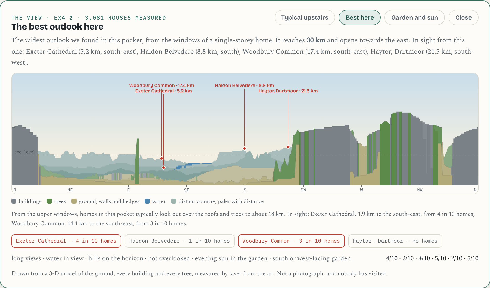

# House by house, and a second city

This picks up where [05-views-without-photos.md](05-views-without-photos.md)
stopped. That document ended with four things still to do. All four are
now done.

| Then | Now |
|---|---|
| One viewpoint per postcode | One at the upper windows and one in the garden of **every house**: 51,513 in Exeter, 38,026 in Bath |
| A coloured strip showing the skyline | A **drawn panorama** of the view, with the sun's path over the garden |
| "Share of homes with long views" | **"Can see the cathedral"** as a search, counted home by home |
| One city | **Two**: Bath was added with no change to the method |

It also re-ran the question from last time, "does the view predict when
a home sells?", in both cities. The answer changed, and section 6 says
so plainly.

## 1. Why house by house matters

Two neighbours share a postcode. One looks across the valley from a
back bedroom. The other looks at the first one's wall. A postcode-level
view has to give them the same answer, and it will be wrong for one of
them.

How often does that happen? We measured how much of the difference
between homes in a city sits *between neighbours on the same postcode*,
rather than between one postcode and the next.

| What we measured | Exeter | Bath |
|---|---|---|
| How open the upstairs skyline is | 81% | 79% |
| Evening sun in the garden | 70% | 57% |
| Sun in the garden in spring and autumn | 69% | 60% |
| How enclosed the garden is | 68% | 59% |
| How overlooked the garden is | 48% | 43% |
| Share of the horizon with a long view | 45% | 36% |
| Water in view | 41% | 48% |

Read the first row as: four fifths of what makes one upstairs view more
open than another is decided house by house, not street by street.

The clearest case is the cathedral itself. In Exeter, on **half of all
postcodes with eight or more houses, some homes can see the cathedral
and others on the same postcode cannot**. Only 1 postcode in 100 has it
in sight from every house. In Bath the figures for the Abbey are 45%
and 2.5%. A postcode-level answer to "can I see the cathedral?" is a
coin toss for half the city.

## 2. How a house's view is worked out

Everything comes from open data: the Environment Agency's laser survey
of the ground and of everything standing on it at 1 metre resolution,
Ordnance Survey building outlines, Ordnance Survey's open list of
address points, and a 30 metre model of the wider landscape out to
30 km.

For each address point:

1. **Find the house.** The point must sit on, or within 3 metres of, a
   building outline. Churches, schools and other public buildings are
   skipped.
2. **Measure it.** Ground level comes from the open ground beside it.
   Roof height comes from the laser survey. Height gives the number of
   storeys, and that gives eye level at the top floor.
3. **Look out from upstairs.** 240 lines of sight, one every 1.5 degrees,
   run out to 30 km. A line starts where it leaves the house's own
   walls, so the house cannot block itself but the neighbour's gable
   can. For each line we record what forms the skyline, how far you can
   see, and whether water or distant hills are in view.
4. **Find the garden.** The largest open, ground-level space beside the
   house that is not a road and is not across a road. Which side of
   the house it lies on is its aspect. 99% of houses in both cities had
   one.
5. **Look out from the garden**, the same way, from standing height.
6. **Work out the sun.** The garden's skyline is compared with the
   sun's path on three days: midsummer, the equinox and midwinter. The
   sun reaches the garden whenever it is higher than the skyline in
   that direction. That gives hours of direct sun, and how much of it
   falls in the evening.
7. **Check each landmark.** Section 3.

A whole city takes ten to fifteen minutes on a four-processor machine. At
that speed every house in England is under 300 processor-hours, a few
hundred pounds of rented computing. The laser survey download, about
half a terabyte, is the larger job.

### What the two cities look like

| Share of addresses | Exeter | Bath |
|---|---|---|
| Long views from upstairs | 49% | 64% |
| Hills on the horizon | 55% | 49% |
| Water in view | 13% | 11% |
| The sea or the estuary in view | 7% | none |
| Garden not overlooked | 24% | 28% |
| Two hours or more of evening sun in the garden in June | 25% | 28% |
| Garden to the south or west of the house | 48% | 49% |

A typical garden gets 12.7 hours of direct sun at midsummer in both
cities, and 3.2 hours at midwinter in Exeter against 2.5 in Bath, where
the valley sides get in the way.

Bath has more long views than Exeter because it is a bowl: most homes
look across it. Exeter sees further when it does see, a typical longest
sight-line of 13 km against 7 km, because it opens to the estuary and
to Dartmoor.

## 3. "Can see the cathedral"

A home counts as having a landmark in sight when a straight line from
its upper windows to the top of the landmark clears everything in
between: every roof and every tree on the 1 metre survey inside the
city, and the terrain beyond it, allowing for the curve of the Earth.

| Exeter | Addresses with it in sight | Bath | Addresses with it in sight |
|---|---|---|---|
| Exeter Cathedral | 22% | Bath Abbey | 26% |
| Haldon Belvedere | 34% | Sham Castle | 38% |
| Woodbury Common | 28% | Beckford's Tower | 24% |
| Haytor, Dartmoor | 2% | Kelston Round Hill | 23% |
| | | Royal Crescent | 15% |
| | | Solsbury Hill | 8% |

It varies enormously by neighbourhood. In Exeter the cathedral is in
sight from 52% of addresses in sector EX4 1 and from 2% in EX1 3. In
Bath the Abbey is in sight from 59% of addresses in BA1 1 and from
almost none in BA2 7.

**The search counts homes jointly.** Ask for "can see the cathedral"
and "evening sun in the garden" together and the prototype counts homes
that have both, not the two averages multiplied. In Exeter that is 4.8%
of addresses. Multiplying the averages would have said 5.5%, because
the homes with the view tend not to be the homes with the sun.

### One correction worth recording

The first full run said 23.1% of Exeter addresses could see the
cathedral. When the views were drawn, a few of those houses plainly had
a tree in the way. The sight-line test started 14 metres out, so that a
house could never block itself, and so it also ignored a hedge or a
neighbour's gable in those first few metres. The test now uses the
closer line already cast from the house, and the figure fell to 22.0%.
A second fix stopped tree canopy over a river being counted as water,
which took "water in view" from 19% to 13%.

Both errors were found by looking at the drawings, which is a good
argument for drawing them.

### What "in sight" does not mean

It means the top of the landmark is visible from the top floor. It does
not say how much of it, from which room, or whether a single tree
planted since the survey has grown into the way. It is a reason to
write to an owner, and something for the buyer to confirm at the
walkthrough.

## 4. The drawn view

The picture above is not a photograph and nobody visited. It is drawn
from the same lines of sight.

Each line of sight is cut into seven distance bands, from the first 25
metres to the far country between 8 and 30 km. For each band we keep
the highest thing in it and what it is: a roof, a tree, open ground,
water. The bands are then painted from the furthest to the nearest,
paler with distance, the way a landscape painter would. Roofs are drawn
flat-topped and trees soft. Low angles are stretched so that distant
hills, which sit only a degree or two above eye level, are not lost.

A landmark is marked only when the house has a clear line to it *and*
the drawing itself shows it above everything nearer. The label and the
picture cannot disagree.

The garden view adds the sun. The three orange lines are the sun's path
at midsummer, the equinox and midwinter. Each is solid where the sun
reaches the garden and dotted where a roof or a tree is in the way.

In the prototype every neighbourhood has three drawings: a typical
upstairs view, the best outlook found there, and a typical garden. On
the owner's page the same drawing appears as "we looked at your view
before we wrote".

## 5. Bath: does it travel?

Yes. Nothing in the method is specific to Exeter. Adding Bath meant:

- naming the area to cover, 14 km by 10 km
- downloading 70 laser-survey tiles and one Ordnance Survey square
- listing six landmarks with their coordinates
- running the same program

The landmarks came out at the right heights without adjustment. The
Abbey tower tops out at 73 metres above sea level, Beckford's Tower at
241, Sham Castle at 187.

Bath also behaved differently in ways that match the place. No tidal
water. Shorter sight-lines. Less winter sun on the valley floor: the
central sector BA1 1 gets a typical 6.7 hours of garden sun at
midsummer and none at midwinter, against 10 to 14 hours at midsummer
in every other part of the city.

## 6. Does the view predict when a home sells? A correction

Last time we reported that it did. In Exeter, homes with long views
sold less often, and adding the view to the model improved its ranking
of future sellers. We said the finding was from one city and needed
repeating.

It has now been repeated, at house level, in two cities. Each test
trains on sales up to 2015 and is scored on sales in 2017 to 2019.

| Test | Ranking score without views | With views | Change, with 95% range |
|---|---|---|---|
| Exeter | 0.5935 | 0.6006 | +0.0073 (+0.0015 to +0.0126) |
| Bath | 0.5890 | 0.5903 | +0.0013 (−0.0060 to +0.0079) |
| Both cities together | 0.5880 | 0.5884 | +0.0003 (−0.0029 to +0.0036) |
| Learn in Exeter, test in Bath | 0.5787 | 0.5731 | −0.0056 (−0.0133 to +0.0016) |
| Learn in Bath, test in Exeter | 0.5933 | 0.5863 | −0.0070 (−0.0141 to −0.0010) |

The ranking score is AUC: 0.5 is a coin toss and 1.0 is perfect.

**The Exeter result holds. It does not travel.** Bath shows no reliable
gain. Worse, what the model learns about views in one city makes it
slightly *worse* in the other. And across the whole country, a
lower-resolution version of the view added nothing at all
([06-national-model-review.md](06-national-model-review.md)).

Why? The table below shows the yearly sale rate for homes in the lowest
and highest quarter of each measure.

| Measure | Exeter, lowest to highest quarter | Bath, lowest to highest quarter |
|---|---|---|
| Long views from upstairs | 6.2% to 5.0% | 5.0% to 5.2% |
| Hills on the horizon | 6.2% to 5.0% | 5.1% to 5.1% |
| Evening sun in the garden | 6.1% to 5.0% | 5.8% to 4.7% |
| How enclosed the garden is | 4.8% to 6.0% | 4.6% to 6.1% |
| How overlooked the garden is | 5.3% to 6.2% | 4.7% to 5.7% |

Two different things are going on.

**Distant views are an Exeter story.** In Exeter the long views belong
to particular settled neighbourhoods on the hills and by the estuary,
where people stay. In Bath nearly everyone has a long view, so having
one says nothing about who you are. The view was standing in for the
neighbourhood.

**Gardens tell the same story in both cities.** Open, sunny,
private gardens sell less often. Enclosed, overlooked ones sell more
often. That holds in both places, and it survives once property type,
price and length of ownership are allowed for. But it is small, and
mostly it is a way of saying "flats and tight terraces change hands
more than houses with proper gardens", which the model already knows.

So the honest position is this. **Views are for the buyer's search, not
for the prediction.** They answer "would I want to live there?" with a
precision no portal has. They do not tell us who is about to sell.

## 7. What it cannot tell you

- **Which window.** Eye level is the top floor at the centre of the
  house. A view to the north from a house whose windows face south is
  counted.
- **Inside the house.** Storeys are estimated from roof height. Loft
  rooms and split levels are guesses.
- **Trees in winter.** The survey records leaf-on canopy as solid.
  Winter views through bare branches are better than drawn.
- **Change since the survey.** New buildings and felled trees since the
  laser flight are not in it. The survey is a composite of flights over
  several years.
- **Which sale record belongs to which house.** Sale records and
  address points share no key in open data, so they meet at the
  postcode. Counts of "owned homes with this view" are therefore
  estimates. A licence for Ordnance Survey's address product removes
  this limit.
- **Flats.** One address point can stand for a whole block. Each flat
  gets the top floor's view.

## 8. What to do with it

1. **Sell the search, not the forecast.** "Can see the cathedral",
   "evening sun in the garden" and the drawn view are things no
   competitor shows, and they need no photograph.
2. **Use the drawing on the postcard page.** An owner who sees their own
   outlook drawn accurately knows the buyer is serious and the
   approach is personal.
3. **Do not pay for views in the targeting model.** Two cities and a
   national test agree that they do not earn their place there.
4. **Roll out city by city.** Each one is roughly an afternoon. The order should
   follow where buyers are, not where the data is: the data is
   everywhere in England.
