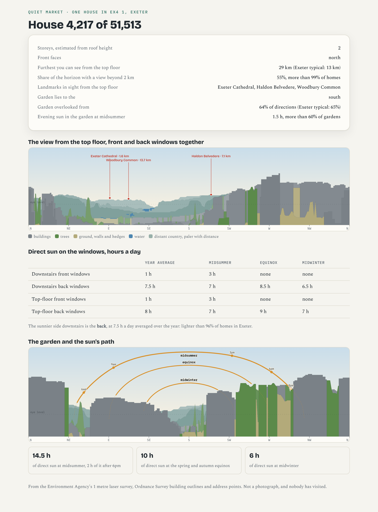
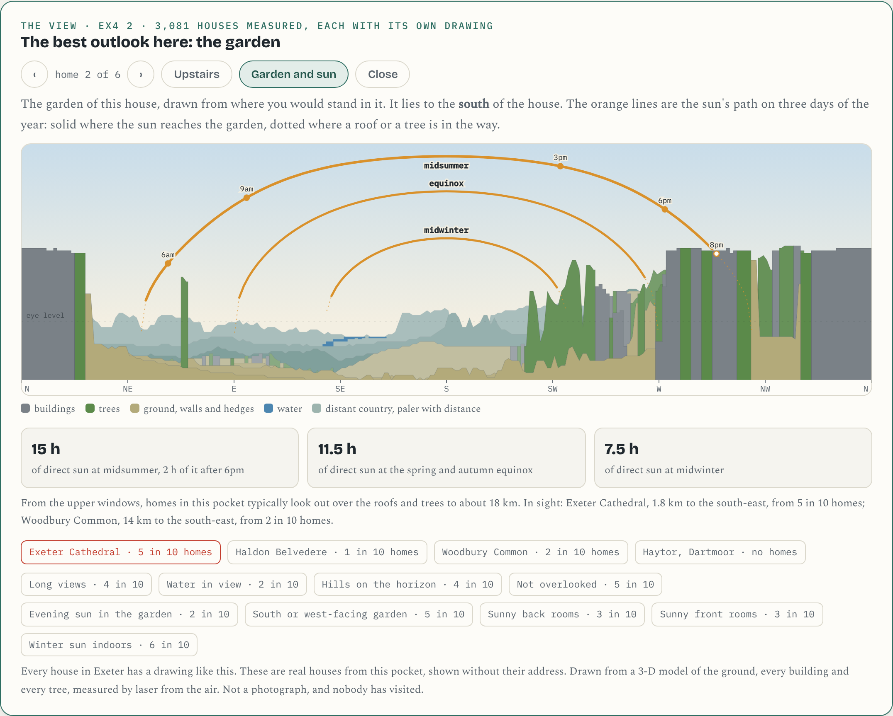
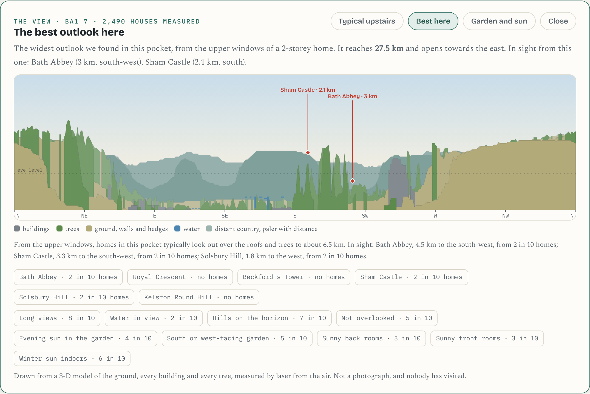
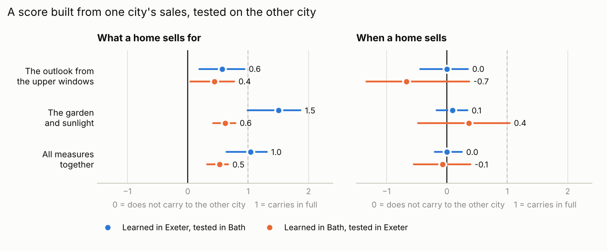
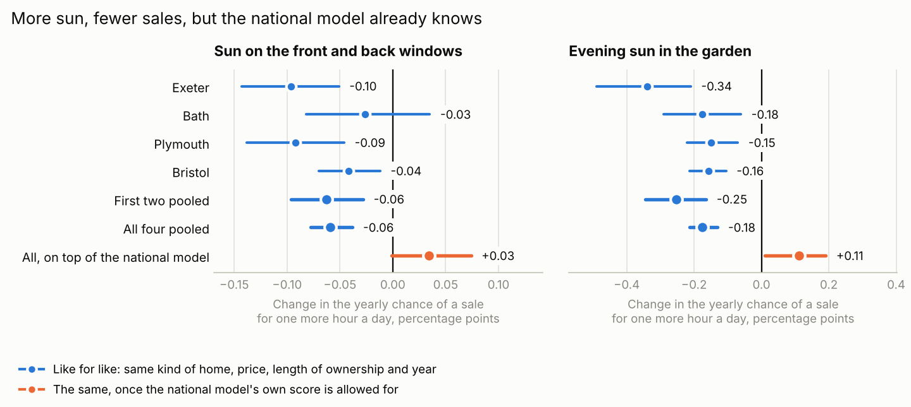

# House by house, and a second city

This picks up where [05-views-without-photos.md](05-views-without-photos.md)
stopped. That document ended with four things still to do. All four are
now done.

| Then | Now |
|---|---|
| One viewpoint per postcode | Three for **every house**: the front upper windows, the back upper windows and the garden. 51,513 houses in Exeter, 38,026 in Bath |
| A coloured strip showing the skyline | A **drawn panorama for every one of those 89,539 houses**, with the sun's path over the garden |
| "Share of homes with long views" | **"Can see the cathedral"** as a search, counted home by home |
| One city | **Two**: Bath was added with no change to the method, and four tests show the method travels |

It also re-ran the question from last time, "does the view predict when
a home sells?", in both cities. The answer changed, and section 6 says
so plainly. Section 7 asks a new one: do people stay longer in homes with
more sun on the windows? Section 8 then takes both questions to four
cities and asks what these measures would add to the national model.

## 1. Why house by house matters

Two neighbours share a postcode. One looks across the valley from a
back bedroom. The other looks at the first one's wall. A postcode-level
view has to give them the same answer, and it will be wrong for one of
them.

How often does that happen? We measured how much of the difference
between homes in a city sits *between neighbours on the same postcode*,
rather than between one postcode and the next.

| What we measured | Exeter | Bath |
|---|---|---|
| How open the upstairs skyline is | 97% | 96% |
| Evening sun in the garden | 70% | 57% |
| Sun in the garden in spring and autumn | 69% | 60% |
| How enclosed the garden is | 68% | 59% |
| How overlooked the garden is | 48% | 43% |
| Share of the horizon with a long view | 45% | 36% |
| Water in view | 45% | 53% |

Read the first row as: almost everything that makes one upstairs view
more open than another is decided house by house, not street by street.

The clearest case is the cathedral itself. In Exeter, on **nearly half
of all postcodes with eight or more houses, some homes can see the
cathedral and others on the same postcode cannot**. Only 1 postcode in
100 has it in sight from every house. In Bath the figures for the Abbey
are 44% and 3%. A postcode-level answer to "can I see the cathedral?" is
a coin toss for half the city.

## 2. How a house's view is worked out

Everything comes from open data: the Environment Agency's laser survey
of the ground and of everything standing on it at 1 metre resolution,
Ordnance Survey building outlines, roads and address points, and a 30
metre model of the wider landscape out to 30 km.

For each address point:

1. **Find the house.** The point must sit on, or within 3 metres of, a
   building outline. Churches, schools and other public buildings are
   skipped.
2. **Measure it.** Ground level comes from the open ground beside it.
   Roof height comes from the laser survey. Height gives the number of
   storeys, and that gives eye level at the top floor.
3. **Find its front and back walls.** The front faces the nearest road.
   From the address point we walk out through the house, front and
   back, until its outline ends, and stand one metre outside each wall.
4. **Look out from upstairs, front and back.** From each of those two
   spots, 240 lines of sight run out to 30 km. The front spot supplies
   the half of the view the front faces, the back spot the other half.
   Because both spots are outside the walls, the house's own roof can
   never hide part of its own view. For each line we record what forms
   the skyline, how far you can see, and whether water or distant hills
   are in view.
5. **Find the garden.** The largest open, ground-level space beside the
   house that is not a road and is not across a road. Which side of
   the house it lies on is its aspect. 99% of houses in both cities had
   one.
6. **Look out from the garden**, the same way, from standing height.
7. **Work out the sun.** The garden's skyline is compared with the
   sun's path on three days: midsummer, the equinox and midwinter. The
   sun reaches the garden whenever it is higher than the skyline in
   that direction.
8. **Check each landmark.** Section 3.
9. **Keep the drawing.** Section 4.

A whole city takes ten to fifteen minutes on a four-processor machine.
At that speed every house in England is under 400 processor-hours, a
few hundred pounds of rented computing. The laser survey download,
roughly half a terabyte, is the larger job.

### What the two cities look like

| Share of addresses | Exeter | Bath |
|---|---|---|
| Long views from upstairs | 49% | 64% |
| Hills on the horizon | 56% | 50% |
| Water in view | 14% | 12% |
| The sea or the estuary in view | 8% | none |
| Garden not overlooked | 24% | 28% |
| Two hours or more of evening sun in the garden in June | 25% | 28% |
| Garden to the south or west of the house | 48% | 49% |

A typical garden gets 12.7 hours of direct sun at midsummer in both
cities, and 3.2 hours at midwinter in Exeter against 2.5 in Bath, where
the valley sides get in the way.

Bath has more long views than Exeter because it is a bowl: most homes
look across it. Exeter sees further when it does see, a typical longest
sight-line of 13 km against 7 km, because it opens to the estuary and
to Dartmoor.

## 3. "Can see the cathedral"

A home counts as having a landmark in sight when a straight line from
its upper windows to the top of the landmark clears everything in
between: every roof and every tree on the 1 metre survey inside the
city, and the terrain beyond it, allowing for the curve of the Earth.
The line starts from whichever wall faces the landmark. The first 150
metres are checked every metre, so that a hedge or a neighbour's gable
close to the house is never stepped over.

| Exeter | Addresses with it in sight | Bath | Addresses with it in sight |
|---|---|---|---|
| Exeter Cathedral | 22% | Bath Abbey | 28% |
| Haldon Belvedere | 26% | Sham Castle | 36% |
| Woodbury Common | 20% | Beckford's Tower | 22% |
| Haytor, Dartmoor | 2% | Kelston Round Hill | 20% |
| | | Royal Crescent | 17% |
| | | Solsbury Hill | 7% |

It varies enormously by neighbourhood. In Exeter the cathedral is in
sight from 59% of addresses in sector EX4 1 and from 2% in EX1 3. In
Bath the Abbey is in sight from 53% of addresses in BA1 1 and from
almost none in BA2 7.

**The search counts homes jointly.** Ask for "can see the cathedral"
and "evening sun in the garden" together and the prototype counts homes
that have both, not the two averages multiplied. In Exeter that is 4.8%
of addresses. Multiplying the averages would have said 5.6%, because
the homes with the view tend not to be the homes with the sun. In Bath
the gap is wider: 5.9% against 7.7%.

### Three corrections, all found by drawing the views

1. **A hedge by the house.** The first full run said 23.1% of Exeter
   addresses could see the cathedral. In the drawings a few of those
   houses plainly had a tree in the way. The sight-line test had started
   14 metres out, so that a house could never block itself, and so it
   also ignored whatever stood in those first few metres. Fixed.
2. **Trees over the river.** Tree canopy over a river was being counted
   as water. Fixing it took "water in view" in Exeter from 19% to 14%.
3. **The house's own roof.** Views were first traced from the address
   point inside the house. In deep houses, such as terraces with long
   back additions, the house's own roof then hid part of its own view.
   Every house in both cities has now been recomputed from just outside
   its front and back walls, which removes the problem at its source. On
   one Bath terrace where the flaw was plain, the typical longest
   sight-line of the affected houses went from 2 km to 7.5 km. Across
   each city, the typical longest sight-line moved by more than a
   quarter on about 1 postcode in 5.

The same recomputation tightened the check on what stands close to the
house. Distant landmarks, which are easiest to hide behind something
near, fell: Haldon Belvedere from 34% of Exeter addresses to 26%,
Woodbury Common from 28% to 20%. The cathedral barely moved, 22.0% to
22.4%, and the Abbey went from 26% to 28%.

All three errors were found by looking at the drawings, which is a good
argument for drawing them.

### What "in sight" does not mean

It means the top of the landmark is visible from the top floor. It does
not say how much of it, from which room, or whether a single tree
planted since the survey has grown into the way. It is a reason to
write to an owner, and something for the buyer to confirm at the
walkthrough.

## 4. The drawn view: one for every house

The page above is one of Exeter's 51,513 houses, chosen by its row in
the table. It is not a photograph and nobody visited. Every house in
both cities has a drawing like it, 89,539 in all.

Each line of sight is cut into seven distance bands, from the first 25
metres to the far country between 8 and 30 km. For each band we keep
the highest thing in it and what it is: a roof, a tree, open ground,
water. The bands are then painted from the furthest to the nearest,
paler with distance, the way a landscape painter would. Roofs are drawn
flat-topped and trees soft. Low angles are stretched so that distant
hills, which sit only a degree or two above eye level, are not lost.

A landmark is marked only when the house has a clear line to it *and*
the drawing itself shows it above everything nearer. The label and the
picture cannot disagree.

The garden view adds the sun. The three orange lines are the sun's path
at midsummer, the equinox and midwinter. Each is solid where the sun
reaches the garden and dotted where a roof or a tree is in the way.

Storing a drawing takes about six thousand bytes a house: one byte for
each direction in each distance band. Both cities together are 146
megabytes. Any house can be drawn from that in about a second, with no
terrain data to hand: `research/src/house_view.py` does it.

In the prototype:

- every neighbourhood shows **six real houses** to page through: a
  typical one, the best outlook found there, and four others from plain
  to fine, each with its upstairs view and its garden
- the owner's page shows a real house **on the owner's own postcode**,
  as "we looked at your view before we wrote"

## 5. Bath: does it travel?

Yes. Four separate tests say so, the last of them the strictest: what is
learned from one city's sales has to predict the other's.

### It runs unchanged

Nothing in the method is specific to Exeter. Adding Bath meant:

- naming the area to cover, 14 km by 10 km
- downloading 70 laser-survey tiles and one Ordnance Survey square
- listing six landmarks with their coordinates
- running the same program

The landmarks came out at the right heights without adjustment. The
Abbey tower tops out at 73 metres above sea level, Beckford's Tower at
241, Sham Castle at 187.

The search works the same way. Here a Bath buyer asks for the Abbey in
sight and evening sun in the garden, and 597 homes across 10
neighbourhoods qualify.

### It gets known places right

Anyone who knows either city knows which streets have the views. We
took hillside streets and streets on low ground in each, found every
house within 35 metres of them, and looked at what the method says.

| Bath | Houses | Ground level | Typical furthest sight-line | Abbey in sight |
|---|---|---|---|---|
| Lansdown Crescent | 26 | 112 m | 28.5 km | 31% |
| Sion Hill | 70 | 106 m | 25.7 km | 57% |
| Bathwick Hill | 143 | 60 m | 25.5 km | 75% |
| Widcombe Hill | 103 | 52 m | 23.0 km | 53% |
| Camden Crescent | 57 | 80 m | 10.8 km | 76% |
| Walcot Street | 167 | 30 m | 6.8 km | 63% |
| Great Pulteney Street | 82 | 23 m | 4.7 km | 65% |
| Livingstone Road | 83 | 27 m | 4.6 km | 4% |
| Lower Bristol Road | 340 | 19 m | 4.1 km | 50% |
| Upper Bristol Road | 296 | 22 m | 3.7 km | 28% |

| Exeter | Houses | Ground level | Typical furthest sight-line | Cathedral in sight |
|---|---|---|---|---|
| Rosebarn Lane | 110 | 105 m | 30.0 km | 25% |
| Barley Lane | 59 | 67 m | 28.8 km | 84% |
| Pennsylvania Road | 180 | 64 m | 22.5 km | 50% |
| Dunsford Road | 84 | 24 m | 22.1 km | 62% |
| Okehampton Street | 41 | 8 m | 13.0 km | 76% |
| Alphington Road | 136 | 7 m | 12.2 km | 61% |
| Sidwell Street | 138 | 47 m | 7.6 km | 54% |
| Cowick Street | 175 | 8 m | 4.9 km | 52% |
| Clifton Road | 100 | 36 m | 1.7 km | 20% |

The hillside streets see five times as far as the low ones in Bath, 23
km against 4.5, and three and a half times as far in Exeter, 25 km
against 7. Camden Crescent, built for its prospect over the city, has
the Abbey in sight from three houses in four. Livingstone Road, a
terrace in the valley, from 1 in 25. The method was built in Exeter and
never tuned for Bath.

Seeing the landmark is a different thing from seeing far. Low streets
near the centre, such as Great Pulteney Street and Okehampton Street,
see the Abbey or the cathedral because they are close to it.

### A view is worth the same in both cities

If "long views" measures something real, homes that have them should
sell for more, and by a similar amount in both places. We took every
sale from 2010 to 2019, 21,196 in Exeter and 15,649 in Bath, and
compared like with like: same kind of home, same neighbourhood, same
year. The table shows how much more a home sells for when it has one
step more of each measure, where a step is the typical gap between one
home and another.

| One step more of | Exeter | Bath |
|---|---|---|
| Share of the horizon with a long view | +4.3% (2.9 to 5.6) | +4.7% (2.7 to 6.6) |
| Furthest sight-line | +3.9% (2.8 to 5.2) | +6.6% (4.3 to 8.7) |
| Water in view | +4.4% (2.9 to 6.0) | +3.4% (1.2 to 5.7) |
| Hills on the skyline | +3.7% (2.2 to 5.3) | +2.8% (1.0 to 4.8) |
| The cathedral or the Abbey in sight | +2.7% (0.9 to 4.6) | +4.8% (3.0 to 6.6) |
| How overlooked the garden is | −5.5% (−7.0 to −4.1) | −8.6% (−10.5 to −6.2) |

Every row has the same sign in both cities, a similar size, and a range
that excludes zero. **Buyers pay for the views this method finds, and
they pay about the same for them in Bath as in Exeter.** That is the
strongest evidence that the numbers mean what they say.

Two cautions. Sale records carry no floor area, so some of each
premium is that homes with views tend to be larger; the next test
allows for that. And two measures did not show a premium: evening sun
in the garden, and sun on the windows. In Bath the lightest homes are
in fact cheaper, because the darkest ones are the grand terraces in the
centre.

### What is learned in one city holds in the other

The table above measures each city on its own and finds the same thing
twice. A stricter test makes one city predict the other.

We built a score from Exeter's sales alone: the weights on the view
measures that best explain Exeter prices, after allowing for the kind
of home, the neighbourhood and the year. Every Bath home was then given
that Exeter-made score, and we asked whether Bath prices follow it. No
Bath sale was used to build the score. Then the same in reverse.

The answer is a slope. A slope of 1 means the premium learned in one
city is paid in full in the other. A slope of 0 means it does not carry
at all.

| Measures in the score | Learned in Exeter, tested in Bath | Learned in Bath, tested in Exeter |
|---|---|---|
| The outlook from the upper windows | 0.57 (0.19 to 0.94) | 0.44 (0.04 to 0.77) |
| The garden and sunlight | 1.50 (0.99 to 1.87) | 0.62 (0.42 to 0.79) |
| All measures together | 1.04 (0.64 to 1.31) | 0.53 (0.32 to 0.67) |

**All six ranges exclude zero.** A score made in Exeter, never shown a
Bath sale, explains Bath prices, and a score made in Bath explains
Exeter's. Each recovers about two thirds of what the other city's own
sales can find with the same measures. The slope is about 1 going to
Bath and about a half going to Exeter, which says the same thing from
both ends: Bath pays more than Exeter for the same view.

This test also deals with size as far as open data allows. On top of
the kind of home, the neighbourhood and the year, it holds fixed the
typical number of storeys, the depth of the house from front to back,
the number of addresses in the building, how open the plot is and
whether there is a garden. Without those the slopes for all measures
together are 1.44 and 0.50, so the answer does not depend on them.

The right-hand panel of the chart is the same test for when a home
sells. That did not travel, and the next section explains.

## 6. Does the view predict when a home sells? A correction

Last time we reported that it did. In Exeter, homes with long views
sold less often, and adding the view to the model improved its ranking
of future sellers. We said the finding was from one city and needed
repeating.

It has now been repeated, at house level, in two cities. Each test
trains on sales up to 2015 and is scored on sales in 2017 to 2019.

| Test | Ranking score without views | With views | Change, with 95% range |
|---|---|---|---|
| Exeter | 0.5935 | 0.6014 | +0.0078 (+0.0018 to +0.0139) |
| Bath | 0.5890 | 0.5875 | −0.0015 (−0.0092 to +0.0053) |
| Both cities together | 0.5880 | 0.5885 | +0.0005 (−0.0025 to +0.0035) |
| Learn in Exeter, test in Bath | 0.5787 | 0.5718 | −0.0066 (−0.0148 to +0.0006) |
| Learn in Bath, test in Exeter | 0.5933 | 0.5903 | −0.0030 (−0.0089 to +0.0031) |

The ranking score is AUC: 0.5 is a coin toss and 1.0 is perfect.

**The Exeter result holds. It does not travel.** Bath shows no gain.
What the model learns about views in one city makes it slightly worse
in the other. And across the whole country, tested on every home, a
lower-resolution version of the view added nothing to choosing between
homes in the same district
([06-national-model-review.md](06-national-model-review.md), section 9).
So Bath agrees with the country, and Exeter is the exception.

The stricter test from section 5 gives the same verdict. A score built
from one city's sale timing, holding the kind of home, its price, the
length of ownership and the year fixed, was tested on the other city:

| Measures in the score | Learned in Exeter, tested in Bath | Learned in Bath, tested in Exeter |
|---|---|---|
| The outlook from the upper windows | 0.00 (−0.44 to +0.35) | −0.67 (−1.33 to +0.37) |
| The garden and sunlight | +0.09 (−0.17 to +0.34) | +0.36 (−0.48 to +1.04) |
| All measures together | 0.00 (−0.20 to +0.25) | −0.07 (−0.55 to +0.39) |

Every range includes zero. These are the same homes, the same measures
and the same method that carried prices cleanly from one city to the
other. The test can tell a pattern that travels from one that does not,
and with two cities sale timing did not. Cutting the 20 view signals in
the model down to five or six chosen in advance made no difference:
neither a short list about the outlook nor one about the garden and
sunlight improved the ranking in the other city.

Two cities leave wide ranges, though. Section 8 repeats this with four,
and the answer for the garden and sunlight firms up: it does carry. The
answer for the outlook does not change.

Why? The table below shows the yearly sale rate for homes in the lowest
and highest quarter of each measure.

| Measure | Exeter, lowest to highest quarter | Bath, lowest to highest quarter |
|---|---|---|
| Long views from upstairs | 6.1% to 4.9% | 5.0% to 5.3% |
| Hills on the horizon | 6.2% to 5.0% | 5.1% to 5.1% |
| Evening sun in the garden | 6.1% to 5.0% | 5.8% to 4.7% |
| How enclosed the garden is | 4.8% to 6.0% | 4.6% to 6.1% |
| How overlooked the garden is | 5.3% to 6.2% | 4.7% to 5.7% |

Two different things are going on.

**Distant views are an Exeter story.** In Exeter the long views belong
to particular settled neighbourhoods on the hills and by the estuary,
where people stay. In Bath nearly everyone has a long view, so having
one says nothing about who you are. The view was standing in for the
neighbourhood.

**Gardens point the same way in both cities.** Open, sunny, private
gardens sell less often. Enclosed, overlooked ones sell more often. Two
cities were too few to say whether that survives a fair comparison.
Four are enough: it does, and section 8 shows it. But it is another way
of saying "flats and tight terraces change hands more than houses with
proper gardens", which the national model already knows.

So the honest position is this. **A view changes what a home is worth,
in both cities. It does not change when its owner sells.** Views are
for the buyer's search and for setting the offer, not for choosing
which doors to write to.

## 7. Is a light home a home people stay in?

A natural next question once the sun's path was on the page: does a home
with plenty of sun on its windows, front or back, keep its owners
longer?

**How the sun on a window is measured.** From the same two spots, one
metre outside the front wall and one metre outside the back, once at
ground-floor window height and once at top-floor height, the skyline is
traced all the way round. A window counts as in direct sun when the sun
is above that skyline and within 75 degrees of square-on to the wall.
The yearly figure averages midsummer, midwinter and the equinox twice.

**What a typical home gets.** Direct sun on the downstairs windows, in
hours a day averaged over the year:

| The front of the house faces | Front windows | Back windows | Front at midwinter | Back at midwinter |
|---|---|---|---|---|
| North | 0.7 | 6.0 | none | 3.2 in Exeter, 2.5 in Bath |
| East | 3.3 | 2.8 | 0.7 | none |
| South | 6.4 | 0.6 | 3.5 in Exeter, 2.7 in Bath | none |
| West | 3.1 | 3.0 | 0.4 | 0.2 |

The sunnier side of a typical home gets about 5 hours a day. One home
in eight in Exeter, and one in six in Bath, gets under 2 hours even on
its sunnier side.

**The raw answer is yes, in both cities.** Split homes into quarters by
how much sun reaches the downstairs windows, front and back together:

| | Darkest quarter | Lightest quarter |
|---|---|---|
| Exeter, share sold each year | 6.0% | 4.7% |
| Bath, share sold each year | 6.0% | 4.7% |
| Roughly, a typical stay of | 17 years | 21 years |

**Most of that gap is the kind of home.** Dark homes are more often
flats and tight terraces, which change hands faster whatever the light.
The fair test holds property type, price, length of ownership and the
year fixed. What is left is the change in the yearly chance of a sale
for each extra hour of daily sun, in percentage points, with its 95%
range:

| Sun on the downstairs windows | Exeter | Bath |
|---|---|---|
| Back, yearly average | −0.09 (−0.14 to −0.05) | +0.04 (−0.02 to +0.09) |
| Front, yearly average | −0.01 (−0.05 to +0.04) | −0.07 (−0.14 to −0.01) |
| Front and back together | −0.10 (−0.14 to −0.04) | −0.03 (−0.08 to +0.03) |
| Back, at midwinter | −0.14 (−0.21 to −0.08) | +0.03 (−0.04 to +0.11) |
| Front, at midwinter | −0.08 (−0.13 to −0.02) | −0.11 (−0.20 to −0.01) |

A minus sign means lighter homes are sold less often.

**Front or back? The two cities disagree.** In Exeter it is the back
that matters: a home with six hours on its back windows rather than one
is about half a point less likely to sell in a year, roughly a year and
a half longer in a typical stay. In Bath the back shows nothing and the
front shows a similar-sized effect. A cleaner test, using only
postcodes where every house faces the same way, repeats the Exeter back
result more strongly (−0.21, range −0.33 to −0.09) and finds nothing in
Bath.

**Why this understates the truth, if there is one.** Between 62% and
77% of the difference in light between homes is between neighbours on
the same postcode: the two sides of one street. Sale records can only
be matched to houses at the postcode, so most of the contrast is
averaged away before the test begins. Matching each sale to its own
house needs licensed address data. With that, this is a one-day test,
and it is the first thing worth running.

**What to take from it.** Light homes are kept longer. With two cities
that was a lead: clear in Exeter, weak in Bath. Section 8 adds two more
cities and it becomes a finding. It is still not a rule about front or
back, and it is far too small to help choose which doors to write to. It is exactly the kind of
thing a buyer wants to search by, so the prototype now offers "sunny
back rooms", "sunny front rooms" and "winter sun indoors".

## 8. More places, and what this adds to the national model

Everything in sections 6 and 7 rested on two cities, and the national
model in [06-national-model-review.md](06-national-model-review.md)
never saw any of it. The house-level measures need the 1 metre laser
survey, which had only been run for Exeter and Bath. The national model
had a coarser stand-in: 22 signals per postcode from 30 metre terrain,
which reproduce a third to a half of the sunlight picture and almost
nothing about front against back.

So two things were untested. Does the sunlight pattern hold up with
more data? And if it does, would it improve the national model?

### Two more cities

Plymouth and Bristol were run through the same program, unchanged.

| | Houses | Home-years in the test | Sales |
|---|---|---|---|
| Exeter | 51,513 | 468,725 | 25,932 |
| Bath | 38,026 | 365,339 | 18,894 |
| Plymouth | 105,157 | 938,634 | 50,640 |
| Bristol | 207,149 | 1,851,242 | 102,599 |
| All four | 401,845 | 3,623,940 | 198,065 |

That is four and a half times the houses and the sales.

### The sunlight pattern is real

The table shows the change in the yearly chance of a sale, in
percentage points, comparing like with like: same kind of home, price,
length of ownership and year. A minus sign means sold less often. Bold
means that city's own range excludes zero.

| One more | Exeter | Bath | Plymouth | Bristol | All four, with range |
|---|---|---|---|---|---|
| Hour of sun a day on the windows, front and back | **−0.10** | −0.03 | **−0.09** | **−0.04** | −0.06 (−0.08 to −0.04) |
| Hour of sun on the front windows at midwinter | **−0.08** | **−0.11** | **−0.13** | **−0.14** | −0.12 (−0.14 to −0.10) |
| Hour of evening sun in the garden | **−0.34** | **−0.18** | **−0.15** | **−0.16** | −0.18 (−0.21 to −0.13) |
| Step of how overlooked the garden is | +0.06 | +0.03 | **+0.15** | **+0.24** | +0.17 (+0.14 to +0.20) |
| Step of long views from upstairs | **−0.24** | **+0.10** | **−0.08** | 0.00 | −0.04 (−0.07 to −0.02) |

Three things follow.

**More data did what it should.** With two cities the range for sun on
the windows was −0.10 to −0.03. With four it is −0.08 to −0.04, two
fifths narrower, and centred in the same place.

**Sun and gardens tell one story everywhere.** Midwinter sun on the
front windows and evening sun in the garden point the same way in all
four cities, each on its own. Plymouth and Bristol had not been looked
at when the pattern was first seen in Exeter, so this is a fair repeat.

**Long views do not.** Exeter says homes with long views sell less
often, Bath says more often, Bristol says no difference. That is the
Exeter-only result from section 6 again.

The stricter test agrees. A sunlight-and-garden score was built from
three cities and tested on the fourth, which it had never seen. A slope
of 1 means it carries in full, 0 that it does not carry.

| City left out | Garden and sunlight score | Outlook score |
|---|---|---|
| Exeter | 0.40 (0.00 to 0.79) | 1.60 (−3.42 to +4.26) |
| Bath | 0.51 (0.03 to 0.91) | −0.01 (−1.21 to +1.19) |
| Plymouth | 0.87 (0.57 to 1.13) | 0.20 (−0.56 to +1.28) |
| Bristol | 0.97 (0.53 to 1.32) | 0.03 (−0.24 to +0.36) |

With two cities this test said "does not carry". With four the garden
and sunlight score carries clearly to three cities and narrowly to
Exeter, and the outlook score carries to none.

How big is it? A home with three more hours of sun a day on its windows
is about 0.2 points less likely to be sold in a year, against a typical
5.5%. Real, and small.

### The national model already knows

The test that matters for the business is different. The every-home
national model scores each home using 73 signals. Would it do better
with these measures added?

We scored every home-year of 2017 and 2018 in the four cities with the
national model. It was trained on sales up to 2015, so it had not seen
those years. That is 468,284 home-years and 20,778 sales. On its own it
finds 1.74 times as many sellers as random in the best tenth of a
district here: 1.69 in Exeter, 1.80 in Bath, 1.60 in Plymouth and 1.81
in Bristol.

First, is anything left in each measure once the national model's own
score is allowed for?

| One more | Like for like | Once the national score is allowed for |
|---|---|---|
| Hour of sun a day on the windows, front and back | −0.06 (−0.08 to −0.04) | +0.03 (0.00 to +0.07) |
| Hour of sun on the front windows at midwinter | −0.12 (−0.14 to −0.10) | −0.03 (−0.08 to +0.02) |
| Hour of evening sun in the garden | −0.18 (−0.21 to −0.13) | +0.11 (+0.01 to +0.19) |
| Step of how overlooked the garden is | +0.17 (+0.14 to +0.20) | +0.02 (−0.05 to +0.09) |
| Step of long views from upstairs | −0.04 (−0.07 to −0.02) | −0.05 (−0.11 to +0.01) |

**Nothing is left.** Four of the five ranges now include zero. The one
that does not, evening sun in the garden, has changed sign: if
anything the national model slightly over-allows for it.

Second, does adding the measures pick better doors? The weights for
combining them with the national score were learned in three cities and
applied to the fourth.

| City left out | National model alone | With garden and sunlight added | Range of the change |
|---|---|---|---|
| Exeter | 1.686 | 1.717 | −0.024 to +0.081 |
| Bath | 1.804 | 1.787 | −0.088 to +0.058 |
| Plymouth | 1.604 | 1.595 | −0.039 to +0.022 |
| Bristol | 1.812 | 1.802 | −0.040 to +0.019 |

**No.** The average change is −0.005. Adding the outlook measures, or
everything together, does no better.

Why would a real pattern add nothing? Because the national model sees
the same thing by another route. Dark homes with overlooked gardens sit
on streets where homes change hands often. The model does not need to
know why: it is given how often homes on that postcode and in that
neighbourhood have sold, what kind of home it is, what it cost and how
long it has been owned. Sunlight explains part of why those streets
turn over. It does not add to knowing that they do.

### What these measures are worth

The same four-city test for price, holding fixed the stand-ins for size
from section 5:

| One more | All four cities, with range | Same sign in |
|---|---|---|
| Step of long views from upstairs | +2.0% (+1.6 to +2.5) | all four |
| Step of how overlooked the garden is | −4.5% (−5.2 to −3.9) | all four |
| Hour of sun on the back windows at midwinter | +1.3% (+0.9 to +1.7) | all four |
| Hour of sun a day on the windows, front and back | +0.8% (+0.3 to +1.2) | three of four |

A score built from all the measures in any three cities predicts prices
in the fourth, with every range clear of zero. So the conclusion of section 6 stands, on
four and a half times the evidence: these measures say what a home is
worth, and the national model already knows when it will sell.

### Should it be run for the whole country?

For the model, no. For the product, yes, city by city as it launches,
because the search and the drawn view need it anyway.

The cost is modest. The two new cities took 127 minutes on four
processors for 312,306 houses. On that footing every house in England
is roughly 450 processor-hours: a little over a day on one rented
16-core machine, plus something like 150 gigabytes of survey tiles.
Wales needs a separate download from Natural Resources Wales.

Two cautions. All four cities are in the South West. And every test
here matches a sale to its postcode, not its house, so the difference
between the two sides of one street, which is most of the difference in
sunlight, never reaches the model. Matching each sale to its own house
is the one thing that could still change this answer.

## 9. What it cannot tell you

- **Which window.** The view joins what can be seen from just outside
  the front wall and just outside the back wall at top-floor height. It
  does not know where the windows are, or that a house has none on one
  side.
- **Side windows and very deep buildings.** Views to the side of a
  detached house are taken from the front and back walls, not the side
  walls. In a block more than 20 metres deep, the walk out from the
  address point stops short of the wall.
- **Inside the house.** Storeys are estimated from roof height. Loft
  rooms and split levels are guesses.
- **Trees in winter.** The survey records leaf-on canopy as solid.
  Winter views through bare branches are better than drawn.
- **Change since the survey.** New buildings and felled trees since the
  laser flight are not in it. The survey is a composite of flights over
  several years.
- **Which sale record belongs to which house.** Sale records and
  address points share no key in open data, so they meet at the
  postcode. Counts of "owned homes with this view" are therefore
  estimates. A licence for Ordnance Survey's address product removes
  this limit.
- **Postcodes at the ends of streets.** Each house is given the nearest
  postcode centre, which is sometimes the next street's. The Office for
  National Statistics publishes an exact list that would remove this.
- **Flats.** One address point can stand for a whole block. Each flat
  gets the top floor's view.

## 10. What to do with it

1. **Sell the search, not the forecast.** "Can see the cathedral",
   "evening sun in the garden" and the drawn view are things no
   competitor shows, and they need no photograph.
2. **Use the drawing on the postcard page.** An owner who sees their own
   outlook drawn accurately knows the buyer is serious and the
   approach is personal.
3. **Use the view to set the offer.** A long view is worth 4% to 5% in
   both cities, and an overlooked garden costs 5% to 9%. The proof-of-
   concept pricing rule ignores both.
4. **Do not pay for views or sunlight in the targeting model.** Four
   cities and a national test on every home agree. The sunlight pattern
   is real, and the national model already has it by another route.
5. **Roll out city by city.** Each one is roughly an afternoon. The
   order should follow where buyers are, not where the data is: the
   data is everywhere in England.
